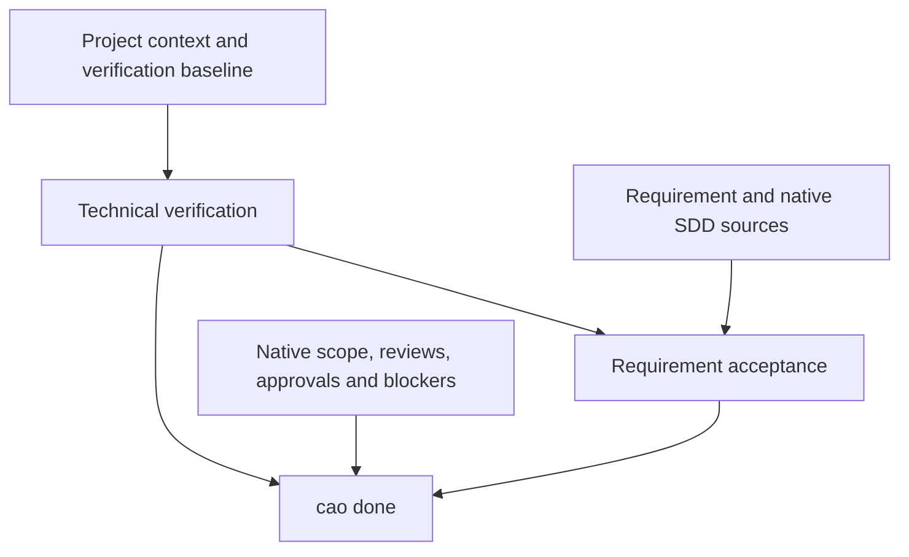

# Coding Agent Orchestrator

English | [简体中文](README.zh-CN.md)

## Project overview

**Coding Agent Orchestrator (CAO)** is a local workflow control plane for AI-assisted software development. It connects coding agents, native spec-driven development (SDD) workflows, and project verification so a requirement can continue across sessions and hosts with traceable progress and completion evidence.

CAO records project technology choices, manages each requirement as a **Work Item**, and checks two parts of delivery: **project technical quality** and **current requirement acceptance**. The agent performs the work; BMAD, OpenSpec, or Spec Kit owns its native specifications and workflow; CAO coordinates progress and evaluates whether the evidence permits completion.

The repository provides adapters for **Claude Code, Codex, and Pi**, a Python CLI, and a local dashboard. It supports existing repositories, new projects, interrupted tasks, and transfers between agents. CAO does not provide a model or call an LLM itself.

## Quick start

### 1. Install CAO

You need **Python 3.10+**, Git to clone the repository, and an installed coding-agent host. The Python core uses the standard library. Pi integration declares **Pi 1.1.0** and **Node.js 22.18.0+**. Provider installers check their own Node.js/uv prerequisites; `cao sdd list` shows detected providers and CLIs.

Install from the repository in a virtual environment. The activation command below is for macOS/Linux; on Windows PowerShell use `.venv\Scripts\Activate.ps1` instead. Use your Python 3.10+ executable if it is named `python3` or `py -3`.

```bash
git clone https://github.com/wymix-tech/coding-agent-orchestrator.git
cd coding-agent-orchestrator
python -m venv .venv
source .venv/bin/activate
python -m pip install .
cao --help
```

Keep this environment available when launching your agent. A source checkout also supports `./cao` or `python scripts/cao.py`; regular use can rely on the installed `cao` command.

### 2. Initialize your product repository

Run these commands in **the project you want CAO to manage**. This example uses Pi; replace `pi` with `claude-code` or `codex` for your actual host. Pi must already be on `PATH` for adapter registration.

```bash
cd /path/to/your-project
cao init --host pi --language en-US
cao host status --host pi
cao bootstrap --host pi
```

`init` creates `.orchestrator/`, registers the selected host integration, and creates missing project instructions. It preserves existing instruction files. Inspect the reported adapter status; if a custom `AGENTS.md` or `CLAUDE.md` already exists, integrate the returned CAO entrypoint with your own instructions. Start or restart the host in this project to load its hooks.

### 3. Select an SDD provider, then restart the host

Follow `bootstrap`'s next action. With no installed provider, choose `bmad`, `openspec`, or `speckit`. A single existing provider can be adopted automatically; multiple installed providers require a choice.

For example, **after choosing OpenSpec**:

```bash
cao sdd list
cao sdd install --provider openspec --host pi --yes
```

`--yes` authorizes the external installation. For an already installed provider, use `cao sdd select --provider openspec` instead. Substitute your chosen provider and actual host.

When CAO reports `HOST_RESTART_REQUIRED`, restart the host in the same project, then run `cao bootstrap --host pi` again. Repeating bootstrap does not acknowledge the restart. Finish this step before project setup or implementation.

### 4. Establish project background and start a requirement

Give the agent a request such as:

> Use CAO to implement an in-memory login service with Java, Spring Boot, Maven, and JUnit 5. Save these choices as project background, establish the verification plan, then register and implement the requirement. Follow `cao next` and report both technical and requirement acceptance results.

The agent follows this order:

1. Restore any pending request returned by bootstrap after restart. Inspect the existing product and saved background with `cao project inspect` and `cao project context show`.
2. Preserve established choices and confirm missing ones. Save them with `cao project context set`, using the observed user evidence ID or established manifest path returned by inspection. Project background does **not** require a Work Item.
3. Reuse existing verification entries. For an empty project, declare a plan first: for example, `cao verification configure --plan-only --test-script "mvn test"` for the Maven project above. This creates no product files and proves no checks passed.
4. Use an existing requirement file, or reserve a path with `cao requirement next-id --title "User login"` and fill that returned file. Then run `cao start --requirement <requirement-path> --title "User login"`.
5. Inside the active Work, create missing build/test scaffolding and configure the real checks without `--plan-only`. Review the baseline as requested, assess the execution path, and follow the selected provider's native workflow.

Commands containing `<...>` require actual returned values. Use `cao project context set --help` to inspect background fields. A source label or agent-written specification is not evidence of a user's technology choice.

`cao next` returns the current action and `guidance.read_before_action` paths. Read those stage/provider instructions and continue from the current state. Initial failing tests do not prevent creating a Work; an accepted verification baseline and native prerequisites must be in place before business implementation.

### 5. Verify, accept, and close

Once the associated native tasks and required reviews are complete, bind the native specification/Intent, inspect the criteria, and configure a real acceptance executor before final verification. For command mode:

```bash
cao acceptance criteria
cao acceptance configure --executor-command "<actual acceptance command>"
```

The executor must follow the [acceptance protocol](references/sdd-acceptance-protocol.md) and return evidence for each criterion. Configuration does not generate assertions or execute checks. If configuration changes require approval or `--reanchor`, follow the returned action before continuing.

```bash
cao verify
cao acceptance run
cao acceptance status
cao next
```

Skill mode uses `cao acceptance begin`, execution of the declared native Skill, and `cao acceptance submit` instead of `run`. Complete remaining native obligations, including a local commit when required, then close:

```bash
cao done
```

Only a successful `cao done` closes the Work. See [completion guidance](references/completion.md) for the complete contract.

Useful daily commands:

| Need | Command |
| --- | --- |
| List requirements / Work Items | `cao requirement list` / `cao list` |
| Inspect progress / next action | `cao status` / `cao next` |
| Save progress | `cao checkpoint --step login-api --next "Run integration tests" --summary "Endpoint implemented"` |
| Record a task decision | `cao decision --decision "Use a short-lived token" --reason "Limit session exposure"` |
| Suspend / reactivate | `cao block --reason "Awaiting API details" --suspend` / `cao resume --work <id> --reactivate` |
| Transfer context | `cao handoff --reason "Transfer to another agent"` |
| Resume from another host | `cao resume --work <id> --host codex` |
| Inspect executions / recovery | `cao runtime runs --work <id>` / `cao runtime recover --work <id> --check` |
| Open the dashboard | `cao dashboard --open` |

Reactivation preserves unresolved blockers; use `cao unblock --work <id> --blocker <blocker-id>` after resolving them. When changing hosts, install its adapter with `cao host install --host <host>` and start it in the same project.

## What CAO implements

### Project context and work continuity

| Capability | Current behavior |
| --- | --- |
| Project background | Stores language, framework, build/test tools, storage, delivery form, versions, and provenance independently of tasks. Supports explicit module scopes and shared root constraints. |
| Requirement tracking | Maintains `todo`, `active`, `suspended`, and `completed` Work states, requirement references, decisions, checkpoints, blockers, and next actions. |
| Session continuity | Associates host sessions and handoffs with Work Items. Restarting or switching agents restores the current task without automatically repeating intake. |
| Controlled project changes | Versions project context and binds changes to a migration Work. Existing tasks can acquire or refresh background bindings without losing their identity or phase. |
| Runtime history | Records task events, controlled command runs, executor receipts, bounded redacted logs, and recovery diagnostics. Recovery does not silently retry commands or mark them passed. |
| Dashboard | Shows Work Items, native artifacts, sessions, blockers, verification, and handoffs from existing state. Local artifact confirmation records the reviewed content hash. |
| Language | Configures communication and native SDD artifact language through `cao language set --language zh-CN` or another locale. |

### Native SDD coordination

CAO keeps specifications in their provider's locations and associates the **whole scope of the current requirement**:

| Provider | Native artifacts and scope checked by CAO |
| --- | --- |
| BMAD | `_bmad-output/` specifications and native review/approval obligations. When sprint tracking applies, bind every related epic/story with `cao sdd plan bind --plan-item <plan-path>#<story-or-epic-id>`; all associated stories must be `done`. |
| OpenSpec | `openspec/` changes, specifications, and task files. All associated changes/tasks must be complete; a validated archive transition can preserve their references. |
| Spec Kit | `specs/` and `.specify/` artifacts. All associated feature implementation task files must be complete; a quality checklist does not substitute for the task plan. |

Repeat `--plan` or `--plan-item` to include split requirements. Completing one story does not complete the requirement. Removing previously observed scope does not turn unfinished work into a pass; `--no-plan` cannot waive real native tasks.

CAO offers three quality profiles, separate from the provider's native route:

| Profile | Intended use | Completion expectations |
| --- | --- | --- |
| `light` | Small, clear changes with limited risk | Targeted technical verification and actual requirement evidence; applicable native prerequisites and reviews still apply. |
| `standard` | Changes needing explicit scope, tests, and review | Scope/implementation review, required tests, technical verification, and independent SDD acceptance. |
| `comprehensive` | Higher-risk or broader changes | Requirements/design/implementation review, technical verification, independent acceptance, and additional gates derived from declared risks. |

The agent assesses scope; CAO enforces minimum profiles for declared risk flags. Security, data migration, irreversible changes, cross-system work, and major ambiguity require `comprehensive`. A profile does not permit skipping the installed provider's workflow.

### Two parts of acceptance

| Part | What it answers | Evidence |
| --- | --- | --- |
| Project technical acceptance | Does this implementation meet the applicable project engineering standard? | Fresh configured build, test, security, integration, or other required script results, bound to relevant project context and inputs. |
| Requirement acceptance | Does the requirement satisfy its native specification, Intent, and acceptance criteria? | Actual per-criterion command or Skill results, source coverage, native scope, and applicable review/approval evidence. |

Each new Work inherits applicable **standards**, not a previous Work's passing results. Both parts must pass and remain fresh; native scope, approvals, reviews, remaining commit obligations, and unresolved blockers also participate in `done`.

`cao acceptance criteria` derives source references from the requirement and native artifacts. It does not determine semantic correctness or invent assertions. `cao acceptance reuse --script <result-name>` can reuse a real technical execution only when its exact command matches the accepted task executor and its original output supplies valid, complete, current item results for the same Work.

## How it works

### Guidance, state, and host adapters

Host adapters translate session/tool events into a shared Python core. `bootstrap`, `next`, host reminders, and completion checks use common prerequisites. Project instructions lead the agent to [SKILL.md](SKILL.md), which loads current stage/provider references on demand.

| Layer | Main implementation |
| --- | --- |
| CLI and guidance | [cao_cli.py](scripts/cao_cli.py), [cao_guidance.py](scripts/cao_guidance.py), [host adapters](hosts) |
| Project context and provenance | [project_context.py](scripts/project_context.py), [project_sources.py](scripts/project_sources.py), [project_verification.py](scripts/project_verification.py) |
| Work, sessions, durable writes | [cao_work_store.py](scripts/cao_work_store.py), [cao_sessions.py](scripts/cao_sessions.py), [state_store.py](scripts/state_store.py) |
| Native workflow and scope | [cao_native_sync.py](scripts/cao_native_sync.py), [cao_plans.py](scripts/cao_plans.py), [provider references](references) |
| Verification and closure | [cao_verification.py](scripts/cao_verification.py), [acceptance_inputs.py](scripts/acceptance_inputs.py), [acceptance_summary.py](scripts/acceptance_summary.py), [cao_completion.py](scripts/cao_completion.py) |
| Runtime diagnostics | [runtime_store.py](scripts/runtime_store.py), [runtime_execution.py](scripts/runtime_execution.py), [runtime_logs.py](scripts/runtime_logs.py) |

State is local, with no separate database service:

| Location | Purpose |
| --- | --- |
| `.orchestrator/config.json` | Project configuration and verification declarations |
| `.orchestrator/project/` | Current context, immutable revisions, provenance, and migrations |
| `.orchestrator/work/<work-id>.json` | Authoritative task state and accepted evidence |
| `.orchestrator/index.json` | Work index and active Work pointer |
| `.orchestrator/requirements/` | Numbered requirement documents |
| `.orchestrator/inputs/<work-id>/route.json` | Agent-authored route declaration at the path returned by CAO |
| `.orchestrator/sessions/` and `.orchestrator/handoffs/` | Session associations and handoff history |
| `.orchestrator/lifecycle/events.jsonl` | Lifecycle audit history |
| `.orchestrator/runtime/<work-id>/` | Execution facts, diagnostic logs, and rebuildable projections |

Repository locks, atomic replacement, revision checks, and an audit-event outbox protect state transitions. Project revisions are written before the current-context pointer changes. Native SDD documents remain in their native directories. Use CLI commands for derived state; requirement documents and the explicitly returned route input are agent-editable inputs.

### Evidence and completion



Verification uses a prepare/execute/commit sequence: register a run under the repository lock, execute outside the lock, then check its identity and current inputs before accepting the result. A superseded run or an input change cannot overwrite the current authoritative result with a pass.

Technical and task evidence bind different inputs. A requirement-only change can retain an applicable technical run while invalidating task evidence. Code, relevant project context, verification scripts, rules, and scope changes may require new checks. A Git commit alone does not change content-based verification inputs.

Configured verification scripts use this exit-code contract:

| Exit code | Meaning |
| --- | --- |
| `0` | Pass |
| `1` | Fail |
| `2` | Blocked / cannot verify |
| `3+` | Execution error |

All required scripts must pass. The runner supports finite `timeout_seconds` (default 300), process cleanup, output tails, and diagnostics. It recognizes common test-count output and rejects detected zero-test runs; custom wrappers must still enforce their own discovery and quality policies. Coverage thresholds and security tools belong to the project's checks, not a fixed CAO percentage or scanner.

Snapshots include untracked product inputs and bind content, file types, and relevant link/permission semantics. `build/`, `dist/`, and `target/` are not automatically excluded. Declare reports with `verification configure --output` and appropriate generated build paths with `--exclude-path`; Git-indexed inputs remain inputs. See [verification setup and snapshot scope](references/verification-setup.md).

For development, see [CONTRIBUTING.md](CONTRIBUTING.md) and [module boundaries](docs/cao-module-structure.md). Checks include Python unittest suites, installed-wheel smoke scenarios, Pi TypeScript checks, and Pi adapter tests. In a development checkout:

```bash
python -m pip install -e .
python -m unittest discover -s tests -v
npm ci --ignore-scripts --no-audit --no-fund
npm run check:pi
npm run test:pi
```

## Q&A

### Does CAO replace BMAD, OpenSpec, Spec Kit, or the coding agent?

No. The agent plans and edits; the SDD supplies its native method and artifacts. CAO persists continuity, coordinates prerequisites, executes configured checks, and evaluates evidence. Installed native instructions remain authoritative for native steps.

### Why establish the technology stack before creating a Work Item?

Language, build tools, test framework, and shared constraints are project facts. Saving them with `cao project context set` avoids temporary tasks and repeated choices. New Works inherit applicable background. For multiple modules, use explicit `--scope` and `--path`; common root constraints still apply.

### Why does bootstrap ask for a restart or enter `verification_setup`?

New host/provider resources must be loaded before work continues. After that, `verification_setup` means real required checks are missing, invalid, or not yet accepted. Use `cao verification configure`; identical declarations return `unchanged`, while different declarations require `--replace`. Configuration readiness is **not verification success**. Do not use `init --force` to bypass setup.

### How do I continue interrupted work or use an older project?

Run `cao bootstrap`, inspect `cao list`, and resume the existing Work. For older tasks missing bindings, establish background and use `cao project bind --work <id>`; use `--refresh` after reviewing changed background. Inspect uncertain runs with `cao runtime recover --work <id> --check`. Recovery preserves progress and cannot convert an unknown outcome into success. See [recovery](references/recovery.md) and [runtime records](references/runtime-records.md).

### Tests passed. Why can `cao done` still refuse completion?

Technical checks are only one part. Criteria may be uncovered, evidence stale, native tasks unfinished, or approvals/reviews/commit steps missing. `cao acceptance status` and `cao next` identify blockers. A one-off `cao verify --script ...` is diagnostic and cannot qualify completion; register real required checks with `verification configure --test-script`.

### Can a small change skip specifications or acceptance?

`light` reduces CAO ceremony while retaining native obligations and behavior evidence. BMAD oneshot can bind its native **Intent** without adding artificial Tasks & Acceptance sections. OpenSpec follows its selected schema; Spec Kit feature implementation still uses native plans/tasks. A formal native acceptance stage may be inapplicable to light, but actual requirement acceptance remains required.

### What happens when requirements, the stack, or verification standards change?

Inspect the changes. Update native bindings and reassess scope as needed; use `cao reopen --reanchor --reason "<reviewed changes>"` when instructed, after any required approval. Material stack changes use `project context change propose` and `change apply` with an owning migration Work. Reanchoring accepts reviewed inputs; it does not create passing evidence. `project context diff` inspects drift, and `project decisions` shows accepted history.

### Does CAO install tools, generate tests, or prove review independence?

Provider installation is an explicit `sdd install --yes` action. The agent prepares project-specific checks; missing dependencies and zero tests must not be treated as success. CAO validates report structure, coverage, run identity, and freshness, but cannot prove natural-language correctness or who performed an independent review. Preserve real findings and execution evidence.

### Are host guards a sandbox? Is the dashboard public?

Guards protect derived state and enforce recognized workflow/write boundaries, but are **not a shell sandbox**. Dynamic or arbitrary scripts cannot be completely analyzed; configured commands are trusted project code. Enforcement depends on connected host events and does not cover arbitrary external edits.

The dashboard binds to `127.0.0.1` by default. Local artifact confirmation records a hash without editing native documents. Non-loopback binding requires `--allow-remote`, disables confirmation, and has no built-in authentication. Runtime logs redact common credentials but cannot identify every business secret.

### How do I change language or upgrade project instructions?

Use `cao language set --language zh-CN` for Chinese or another supported locale. Preview changes with `cao instructions update --host pi`, then apply eligible changes with `--apply` and restart the host. The updater backs up replaced CAO content and preserves custom files/sections it cannot safely identify. Use your actual host name.

## MIT License

Copyright (c) 2026 Coding Agent Orchestrator contributors.

This project is licensed under the [MIT License](LICENSE). The complete permission notice and warranty disclaimer are in `LICENSE`.
