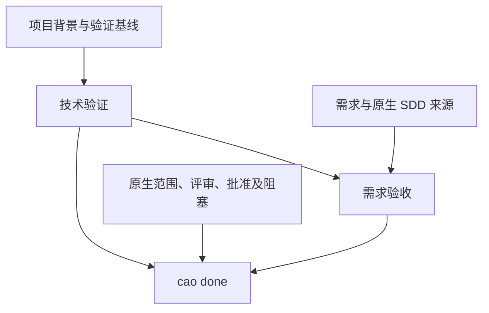

# Coding Agent Orchestrator

[English](README.md) | 简体中文

## 项目概要

**Coding Agent Orchestrator（CAO）** 是面向 AI 编程的本地工作流控制层。它连接编程 Agent、原生规范驱动开发（SDD）流程和项目验证，让一个需求在会话中断、宿主重启或切换 Agent 后仍能继续推进，并保留可追溯的进度与完成证据。

CAO 记录项目技术选型，将每个需求管理为一个 **Work Item（工作项）**，并从 **项目级技术质量** 和 **当前需求验收** 两个方面判断能否交付。Agent 负责执行开发，BMAD、OpenSpec 或 Spec Kit 负责原生规范和流程，CAO 负责协调进度、检查证据与控制任务关闭。

项目提供 **Claude Code、Codex、Pi** 适配器、Python CLI 和本地可视化面板，适用于已有项目、新项目、中断恢复与跨 Agent 交接。CAO 本身不提供模型，也不直接调用大模型。

## 快速上手

### 1. 安装 CAO

需要 **Python 3.10+**、用于克隆仓库的 Git，以及已安装的编程 Agent 宿主。Python 核心使用标准库。Pi 集成声明的版本为 **Pi 1.1.0**、**Node.js 22.18.0+**。Provider 安装器会检查各自的 Node.js、uv 等前置条件；`cao sdd list` 用于查看已检测到的 Provider 和 CLI。

从源码仓库安装到虚拟环境。以下激活命令适用于 macOS/Linux；Windows PowerShell 使用 `.venv\Scripts\Activate.ps1`。如果你的 Python 3.10+ 命令名是 `python3` 或 `py -3`，请相应替换。

```bash
git clone https://github.com/wymix-tech/coding-agent-orchestrator.git
cd coding-agent-orchestrator
python -m venv .venv
source .venv/bin/activate
python -m pip install .
cao --help
```

启动 Agent 时应保持该环境可用。源码目录也支持通过 `./cao` 或 `python scripts/cao.py` 执行；日常使用推荐安装后的 `cao` 命令。

### 2. 初始化目标项目

在 **需要 CAO 管理的项目目录** 中执行。下面以 Pi 为例；使用其他宿主时，将 `pi` 替换为 `claude-code` 或 `codex`。注册 Pi 适配器前，需要确保 `pi` 命令已在 `PATH` 中。

```bash
cd /path/to/your-project
cao init --host pi --language zh-CN
cao host status --host pi
cao bootstrap --host pi
```

`init` 创建 `.orchestrator/`、注册所选宿主的集成，并补充缺失的项目指引文件；已有指引文件会保留。请检查返回的适配器状态。如果项目已有自定义 `AGENTS.md` 或 `CLAUDE.md`，应将返回的 CAO 入口与原规则整合。在当前项目启动或重启宿主，让 Hook 生效。

### 3. 选择 SDD Provider，并重启宿主

按照 `bootstrap` 返回的下一步操作执行。没有安装 Provider 时，选择 `bmad`、`openspec` 或 `speckit`。只有一个已安装的 Provider 时可自动采用；安装了多个时需要明确选择。

例如，**明确选择 OpenSpec 后**：

```bash
cao sdd list
cao sdd install --provider openspec --host pi --yes
```

`--yes` 表示授权执行外部安装。若项目已安装该 Provider，使用 `cao sdd select --provider openspec` 即可。请替换为你实际选择的 Provider 和宿主。

当 CAO 返回 `HOST_RESTART_REQUIRED` 时，在同一项目重启宿主，再执行 `cao bootstrap --host pi`。反复执行 bootstrap 不能代替重启。完成这一步后，才能继续项目背景设置和开发。

### 4. 建立项目背景，开始需求

现在可以向 Agent 提出需求，例如：

> 使用 CAO 开发一个基于内存的用户登录服务，采用 Java、Spring Boot、Maven 和 JUnit 5。先把这些选择保存为项目背景并建立验证计划，再登记需求、开始实现。遵循 `cao next` 推进，最后分别报告项目技术验收和需求验收结果。

Agent 应按以下顺序推进：

1. 恢复重启后 bootstrap 返回的待处理需求，再通过 `cao project inspect`、`cao project context show` 检查已有产品和保存的项目背景。
2. 保留已确定的技术选型，只确认缺失部分。使用 `cao project context set` 保存，并引用检查结果中的真实用户证据 ID 或已有产品清单路径。保存项目背景 **不需要先创建 Work Item**。
3. 复用已有验证入口。空项目先声明计划，例如上述 Maven 项目可执行 `cao verification configure --plan-only --test-script "mvn test"`。该命令不创建产品文件，也不代表检查已经通过。
4. 使用已有需求文件，或通过 `cao requirement next-id --title "用户登录"` 分配路径并填写返回的文件，再执行 `cao start --requirement <requirement-path> --title "用户登录"`。
5. 在活动 Work 内创建缺失的构建、测试脚手架，去掉 `--plan-only` 配置真实验证入口；按提示审查验证基线、评估执行路径，再进入所选 Provider 的原生流程。

命令中的 `<...>` 需要替换为实际返回的值。项目背景字段可通过 `cao project context set --help` 查看。仅填写来源标签、或由 Agent 自行编写一份规范，都不能作为用户技术选型的授权证据。

`cao next` 返回当前动作和 `guidance.read_before_action` 路径。读取对应阶段及 Provider 指引后，从当前状态继续。初始测试失败不妨碍创建 Work；开始业务实现前，需要具备已接受的验证基线并满足原生流程前置条件。

### 5. 验证、验收与关闭

关联的原生任务和必要评审完成后，绑定原生规范或 Intent，检查验收条目，并在最终验证前配置真实验收执行器。命令模式示例：

```bash
cao acceptance criteria
cao acceptance configure --executor-command "<actual acceptance command>"
```

执行器必须遵循 [验收协议](references/sdd-acceptance-protocol.md)，为每个条目返回实际证据。配置动作不会自动生成断言，也不会执行检查。如果配置变化要求批准或 `--reanchor`，先按返回的动作处理。

```bash
cao verify
cao acceptance run
cao acceptance status
cao next
```

Skill 模式使用 `cao acceptance begin`、执行声明的原生 Skill、`cao acceptance submit`，代替 `run`。完成剩余原生义务，包括流程要求的本地提交，再关闭任务：

```bash
cao done
```

只有 `cao done` 成功，Work 才算完成。完整规则见 [验证、验收与关闭指引](references/completion.md)。

日常常用命令：

| 需求 | 命令 |
| --- | --- |
| 查看需求文档 / Work 列表 | `cao requirement list` / `cao list` |
| 查看进度 / 下一步 | `cao status` / `cao next` |
| 保存进度 | `cao checkpoint --step login-api --next "执行集成测试" --summary "接口已实现"` |
| 记录任务决策 | `cao decision --decision "使用短期令牌" --reason "限制会话暴露时间"` |
| 暂停 / 重新激活 | `cao block --reason "等待接口信息" --suspend` / `cao resume --work <id> --reactivate` |
| 交接上下文 | `cao handoff --reason "转交其他 Agent"` |
| 换宿主继续 | `cao resume --work <id> --host codex` |
| 查看执行记录 / 恢复诊断 | `cao runtime runs --work <id>` / `cao runtime recover --work <id> --check` |
| 打开可视化面板 | `cao dashboard --open` |

重新激活不会自动清除未解决的阻塞；实际解决后，使用 `cao unblock --work <id> --blocker <blocker-id>`。切换宿主时，先用 `cao host install --host <host>` 安装对应适配器，再在同一项目启动该宿主。

## 本项目实现了什么

### 项目背景与任务连续性

| 能力 | 当前实现 |
| --- | --- |
| 项目背景 | 独立于任务保存语言、框架、构建与测试工具、存储、交付形式、版本及来源；支持显式模块范围和根级公共约束。 |
| 需求跟踪 | 维护 `todo`、`active`、`suspended`、`completed` 状态，以及需求引用、决策、检查点、阻塞和下一步。 |
| 会话连续性 | 将宿主会话和交接记录关联到 Work；重启或更换 Agent 后恢复当前任务，不因会话变化自动重做需求登记。 |
| 项目受控变更 | 对项目背景做版本管理，将变更绑定到负责迁移的 Work；旧任务可补充或刷新背景绑定，保留身份与阶段。 |
| 运行历史 | 保存任务事件、受控命令执行、执行器回执、有容量限制的脱敏日志和恢复诊断；恢复不会静默重试命令或补成通过。 |
| 可视化面板 | 从现有状态展示 Work、原生产物、会话、阻塞、验证和交接；本地产物确认保存被审阅内容的哈希。 |
| 语言设置 | 通过 `cao language set --language zh-CN` 等命令设置交流和原生 SDD 文档使用的语言。 |

### 原生 SDD 协调

CAO 保留各 Provider 的原生文档位置，并关联 **当前需求的完整执行范围**：

| Provider | CAO 关联和检查的原生产物与范围 |
| --- | --- |
| BMAD | `_bmad-output/` 中的规范及原生评审、批准义务。使用 sprint 跟踪时，通过 `cao sdd plan bind --plan-item <plan-path>#<story-or-epic-id>` 关联全部相关 epic/story；相关 story 必须全部为 `done`。 |
| OpenSpec | `openspec/` 中的 change、规范和任务文件；所有关联 change/task 都需要完成，经过验证的归档迁移可保持引用连续。 |
| Spec Kit | `specs/`、`.specify/` 中的原生产物；检查全部关联功能的实现任务文件，质量检查清单不能替代实现计划。 |

需求拆分到多个计划时，重复使用 `--plan` 或 `--plan-item` 关联。完成一个 story 不等于完成整个需求；删除已观察到的任务范围不能让未完成工作变成通过，`--no-plan` 也不能豁免真实存在的原生任务。

CAO 提供三种质量档位，与 Provider 自己选择的原生路线分别管理：

| 档位 | 适用情况 | 完成要求 |
| --- | --- | --- |
| `light` | 范围小、目标清晰、风险有限的改动 | 有针对性的技术验证和真实需求证据；适用的原生前置条件及评审仍需完成。 |
| `standard` | 需要明确范围、测试和评审的改动 | 范围与实现评审、必要测试、技术验证、独立 SDD 验收。 |
| `comprehensive` | 较高风险或更广范围的改动 | 需求、设计与实现评审、技术验证、独立验收，以及按声明风险追加的门禁。 |

Agent 负责评估范围，CAO 对声明的风险标记执行最低档位约束。安全、数据迁移、不可逆操作、跨系统改动、重大歧义要求 `comprehensive`。选择某个档位不意味着可以跳过已安装 Provider 的流程。

### 双层验收

| 层次 | 回答的问题 | 所需证据 |
| --- | --- | --- |
| 项目级技术验收 | 当前实现是否符合适用的项目工程标准？ | 配置的编译、测试、安全、集成或其他必要脚本的有效执行结果，并绑定相关项目背景与输入。 |
| 当前任务需求验收 | 当前需求是否满足原生规范、Intent 和验收条目？ | 逐条命令或 Skill 的真实结果、来源覆盖、原生执行范围及适用的评审和批准证据。 |

新 Work 继承适用的 **标准**，不继承其他 Work 的通过结果。两层都必须通过且证据仍然有效；原生范围、批准、评审、剩余提交义务和未解决阻塞，也共同参与 `done` 的判断。

`cao acceptance criteria` 从需求和原生产物派生来源引用，不会自动判断自然语言的语义正确性，也不会凭空生成断言。仅当技术运行的精确命令与已接受的需求验收入口一致，且原始输出包含同一 Work 完整、有效、未过期的条目结果时，才可通过 `cao acceptance reuse --script <result-name>` 复用这次真实运行。

## 怎么实现的

### 指引、状态与宿主适配

宿主适配器把会话和工具事件转换为统一 Python 核心可处理的事件。`bootstrap`、`next`、宿主提醒和完成检查共享前置条件。项目指引将 Agent 导向 [SKILL.md](SKILL.md)，再按需加载当前阶段和 Provider 的引用文档。

| 层次 | 主要实现 |
| --- | --- |
| CLI 与执行指引 | [cao_cli.py](scripts/cao_cli.py)、[cao_guidance.py](scripts/cao_guidance.py)、[宿主适配器](hosts) |
| 项目背景与来源 | [project_context.py](scripts/project_context.py)、[project_sources.py](scripts/project_sources.py)、[project_verification.py](scripts/project_verification.py) |
| Work、会话与持久化 | [cao_work_store.py](scripts/cao_work_store.py)、[cao_sessions.py](scripts/cao_sessions.py)、[state_store.py](scripts/state_store.py) |
| 原生流程与范围 | [cao_native_sync.py](scripts/cao_native_sync.py)、[cao_plans.py](scripts/cao_plans.py)、[Provider 指引](references) |
| 验证与关闭 | [cao_verification.py](scripts/cao_verification.py)、[acceptance_inputs.py](scripts/acceptance_inputs.py)、[acceptance_summary.py](scripts/acceptance_summary.py)、[cao_completion.py](scripts/cao_completion.py) |
| 运行诊断 | [runtime_store.py](scripts/runtime_store.py)、[runtime_execution.py](scripts/runtime_execution.py)、[runtime_logs.py](scripts/runtime_logs.py) |

状态保存在项目本地，不需要独立数据库服务：

| 位置 | 用途 |
| --- | --- |
| `.orchestrator/config.json` | 项目配置与验证声明 |
| `.orchestrator/project/` | 当前背景、不可变版本、来源和迁移记录 |
| `.orchestrator/work/<work-id>.json` | 权威任务状态及接受的证据 |
| `.orchestrator/index.json` | Work 索引及当前活动 Work 指针 |
| `.orchestrator/requirements/` | 编号需求文档 |
| `.orchestrator/inputs/<work-id>/route.json` | CAO 返回路径下、由 Agent 编写的路线声明 |
| `.orchestrator/sessions/`、`.orchestrator/handoffs/` | 会话关联及交接历史 |
| `.orchestrator/lifecycle/events.jsonl` | 生命周期审计历史 |
| `.orchestrator/runtime/<work-id>/` | 执行事实、诊断日志及可重建的展示数据 |

仓库锁、原子替换、版本检查和审计事件 outbox 保护状态转换。项目背景先写入不可变版本，再切换当前版本指针。SDD 文档保留在各自的原生目录。派生状态通过 CLI 修改；需求文档和明确返回的路线输入允许 Agent 编写。

### 证据绑定与完成判断



验证采用“准备、执行、提交结果”三个步骤：在仓库锁内登记运行，释放锁后执行命令，最后重新核对运行身份和当前输入，决定是否接受结果。已被新运行取代的旧结果，或执行期间输入发生变化的结果，不能覆盖当前权威状态并宣告通过。

技术证据和任务证据绑定不同输入。仅需求变化时，适用的原技术运行可以保留，但任务证据需要刷新。代码、相关项目背景、验证脚本、规则和范围变化可能要求重新检查。单纯执行 Git commit 不改变基于内容的验证输入。

配置的验证脚本遵循以下退出码约定：

| 退出码 | 含义 |
| --- | --- |
| `0` | 通过 |
| `1` | 失败 |
| `2` | 阻塞 / 无法验证 |
| `3+` | 执行错误 |

全部必要脚本都必须通过。执行器支持有限的 `timeout_seconds`（默认 300 秒）、进程清理、输出尾部和诊断记录；可识别常见测试数量输出，拒绝检测到的零测试运行。自定义包装脚本仍需自行落实测试发现和质量策略。覆盖率阈值及安全工具由项目检查定义，CAO 没有固定的覆盖率百分比或内置指定扫描器。

快照包含未跟踪的产品输入，并绑定内容、文件类型及适用的链接、权限语义。`build/`、`dist/`、`target/` 不会自动排除。报告产物用 `verification configure --output` 声明，适当的构建产物路径用 `--exclude-path` 声明；Git 索引中的输入仍会纳入。详情见 [验证基线与快照范围](references/verification-setup.md)。

参与开发可阅读 [CONTRIBUTING.md](CONTRIBUTING.md) 和 [模块边界](docs/cao-module-structure.md)。项目已有 Python unittest、仓库外 wheel 安装冒烟、Pi TypeScript 检查及适配器测试。在开发目录执行：

```bash
python -m pip install -e .
python -m unittest discover -s tests -v
npm ci --ignore-scripts --no-audit --no-fund
npm run check:pi
npm run test:pi
```

## Q&A

### CAO 会替代 BMAD、OpenSpec、Spec Kit 或编程 Agent 吗？

不会。Agent 负责规划和修改，SDD 提供原生方法与产物。CAO 保存连续性、协调前置条件、执行配置的检查并判断证据。原生步骤仍以实际安装的原生指引为准。

### 为什么先确定技术栈，再创建 Work Item？

语言、构建工具、测试框架和公共约束属于项目事实。通过 `cao project context set` 保存后，无需创建临时任务，也无需每个需求重复选择。新 Work 继承适用背景；多模块项目通过 `--scope`、`--path` 明确范围，同时遵守根级公共约束。

### 为什么 bootstrap 要求重启，或者进入 `verification_setup`？

新安装的宿主或 Provider 资源需要先被宿主加载。之后出现 `verification_setup`，表示必要的真实检查缺失、无效或尚未被接受。使用 `cao verification configure` 配置；相同声明返回 `unchanged`，替换不同声明需要 `--replace`。配置就绪不等于验证成功，不要用 `init --force` 跳过设置。

### 中断后如何继续？旧项目如何接入新的项目背景？

执行 `cao bootstrap`，通过 `cao list` 查看并恢复原 Work。旧任务缺少背景绑定时，先建立项目背景，再执行 `cao project bind --work <id>`；背景变化经审查后才使用 `--refresh`。运行结果不确定时，用 `cao runtime recover --work <id> --check` 诊断。恢复保留进度，不会把未知结果改成成功。详见 [恢复指引](references/recovery.md) 和 [运行记录](references/runtime-records.md)。

### 测试通过了，为什么 `cao done` 仍然不允许完成？

技术检查只是一部分。可能还存在未覆盖的验收条目、过期证据、未完成的原生任务，或缺少批准、评审、提交。`cao acceptance status` 和 `cao next` 会指出阻塞。临时执行的 `cao verify --script ...` 只用于诊断，不能作为关闭依据；正式检查应通过 `verification configure --test-script` 登记。

### 很小的改动可以跳过规范或验收吗？

`light` 减少 CAO 的流程负担，但仍保留原生义务和行为证据。BMAD oneshot 可以绑定原生 **Intent**，不用人为添加 Tasks & Acceptance 段落。OpenSpec 遵守所选 schema，Spec Kit 功能实现仍使用原生计划与任务。light 的正式原生验收阶段可以不适用，实际需求验收仍必须完成。

### 需求、技术栈或验证标准变化后怎么办？

先检查变化，按需更新原生绑定、重新评估范围；提示需要时，在取得必要批准后执行 `cao reopen --reanchor --reason "<reviewed changes>"`。实质技术栈变化通过 `project context change propose`、`change apply` 交由负责迁移的 Work 推进。重新锚定表示接受经过审查的输入，不会产生通过证据。`project context diff` 用于检查偏差，`project decisions` 用于查看已接受的历史。

### CAO 会自动安装工具、生成测试，或者证明评审独立性吗？

Provider 安装通过显式的 `sdd install --yes` 执行。项目专用检查由 Agent 准备；缺少依赖或零测试不能视为成功。CAO 校验报告结构、覆盖关系、运行身份和证据有效性，但不能证明自然语言语义正确，也不能证明某次独立评审究竟由谁执行。需要保留真实发现和执行证据。

### 宿主门禁是安全沙箱吗？面板会公开到网络吗？

门禁保护派生状态，并约束能够识别的工作流与写入边界，但 **不是 Shell 安全沙箱**。动态命令和任意脚本无法被完全分析；配置的命令属于受信任的项目代码。约束依赖已连接的宿主事件，不能覆盖任意外部修改。

面板默认绑定 `127.0.0.1`。本地产物确认记录哈希，不修改原生文档。绑定非回环地址需要 `--allow-remote`，会禁用确认功能，且没有内置身份认证。运行日志会脱敏常见凭据，但不能识别所有业务秘密。

### 如何切换语言或升级项目指引？

中文可用 `cao language set --language zh-CN`，也可选择其他支持的语言。先用 `cao instructions update --host pi` 预览，再加 `--apply` 应用符合条件的变化并重启宿主。更新器备份被替换的 CAO 内容，保留无法安全识别的自定义文件或段落。请使用实际宿主名称。

## MIT License

Copyright (c) 2026 Coding Agent Orchestrator contributors.

本项目采用 [MIT License](LICENSE)。完整许可声明及免责声明见 `LICENSE` 文件。

## 过程符合性与项目知识

SDD provider 负责功能代码评审；CAO 核查声明的产物、过程及有效证据，并复用原生评审结果满足对应门禁。`cao conformance show/check` 展示当前义务和阻塞原因。BMAD 的 `cao sdd review prepare` 提前创建全部层的票据和报告路径，`import` 校验已有原生报告，避免为格式补齐重复评审。

评审完成和任务关闭后可自动采集带来源、范围及失效检查的项目知识；采集失败不会阻塞完成。通过 `cao knowledge list/collect/refresh` 管理，配置 `knowledge.enabled: false` 可关闭。详见[过程符合性与知识协议](references/conformance-knowledge.md)。
