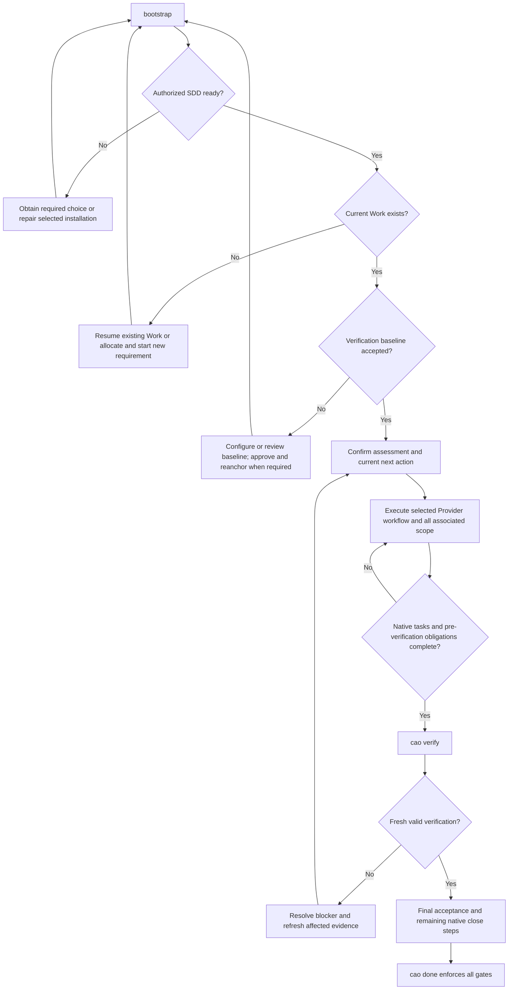

# Coding Agent Orchestrator

## Start here

1. Use the actual CAO invocation installed in project instructions; do not guess paths.
   `cao` in this Skill and its references is shorthand for that invocation.
2. Run `cao bootstrap` before repository coding work. It reports current Work and next action;
   it does not create a Work or repeat intake because the session changed.
3. Read the current output's `guidance.read_before_action` files, then execute its `next`
   (`bootstrap`) or `action` (`next`). If guidance resources are missing, repair the installation;
   do not invent the missing instructions or bypass gates.
4. Read only the stage guide and current Provider guide required for this action. References
   below resolve relative to this Skill's root, not the product repository's working directory.
5. After resolving startup/setup, rerun bootstrap. During execution follow `cao next` and the
   installed native workflow. After meaningful slices checkpoint; after material changes refresh
   only applicable invalidated evidence. A resumed Work continues from its current phase.

## Load on demand

| Condition | Read before acting |
| --- | --- |
| `sdd_select`, `sdd_install_required`, language/host installation trouble | [Startup](references/startup.md) |
| No current Work, select/resume requirement, session transfer | [Work intake and continuity](references/work-intake.md) |
| `verification_setup`, changed scripts/capabilities/`timeout_seconds` or wrappers | [Verification baseline](references/verification-setup.md) |
| Missing assessment, native workflow/plan/scope work | [Execution path and scope](references/execution.md) |
| Current Provider is BMAD and native workflow action is needed | [BMAD](references/provider-bmad.md) |
| Current Provider is OpenSpec and native workflow action is needed | [OpenSpec](references/provider-openspec.md) |
| Current Provider is Spec Kit and native workflow action is needed | [Spec Kit](references/provider-speckit.md) |
| Review/verification/final acceptance/close | [Completion](references/completion.md) |
| Blockers, requirement changes, stale evidence, missing sources or abandoned runs | [Recovery](references/recovery.md) |
| Need route declaration, BMAD approval or review report fields | [Native route contract](docs/native-route-contract.md) |
| Need independent acceptance declaration or report fields | [Acceptance protocol](docs/sdd-acceptance-protocol.md) |

Read the relevant file completely when entering its stage. Do not preload unrelated Providers,
all references, source scripts, README or historical repair notes. Links are navigation, not automatic
loading. If a native Skill requires a renderer, run its exact installed renderer and read the result;
rendering loads instructions and does not execute/complete the workflow.

## Execution flow

The diagram shows dependencies. Resume at the current state; Provider-native instructions determine
internal planning, implementation, review, Classify, Finalize and Commit order.

Configure standard/comprehensive acceptance sources before the final verify/reanchor as directed by
completion guidance. Perform required native commits at their native step; commit alone does not
require reanchoring. Any input change can require fresh reviews/bindings/verification.

## Always preserve these boundaries

- CAO owns Work, execution state, next actions, decisions, blockers, sessions, handoffs and evidence
  freshness. The selected SDD owns PRD/spec/design/tasks/stories and native workflow. Store native
  references; do not copy artifacts just to make their format uniform.
- Everything under `.orchestrator/` except `requirements/` is CAO-derived state. Never edit config,
  index, Work, sessions, handoffs or lifecycle files by hand; use their CAO commands.
- Respect the current user's instructions and language. Read `language.user` through `cao language
  show`; apply an ongoing changed preference with `cao language set --language <locale>`. Write
  native artifacts in that language while preserving code/API names, commands and required tokens.
- Create/resume Work before product code, configuration, tests or verification scaffolding. New
  inline requirements use `cao requirement next-id`; use an existing requirement file directly.
- Establish an accepted required verification baseline before business implementation, then assess
  the path and satisfy native prerequisites. Initial build/test scaffolding may fail; passing tests
  are not a prerequisite to creating Work or beginning implementation after its prerequisites.
- Keep CAO profile (`light`, `standard`, `comprehensive`) separate from native route. Light still
  follows native prerequisites, actual task scope and required independent reviews. Do not
  manufacture workflow/plan/no-plan/final-acceptance records merely for light.
- Associate ALL this requirement's execution units. `--plan-item` selects related BMAD stories/epics;
  repeated plans cover split changes/features. `--no-plan` cannot waive actual SPEC tasks.
- Never invent approvals, independent reviewers, execution, artifacts or passing evidence. Only
  observed manual gates use `gate satisfy`; tests/security/verification and final acceptance derive
  from actual configured runs. A placeholder entrypoint or product source file is not SDD evidence.
- Missing tools/dependencies or zero tests must block/fail. Preserve the user's stack/runner and
  delivery choices. Configure required tests using `verification configure --test-script`; no fake
  `echo`/`true` pass, automatic dependency installation, script overwrite or `init --force` shortcut.
- Requirement/intent/route/rule/baseline changes require the applicable review, `--reanchor`, binding
  or reassessment. Do not recover by restarting intake, replacing Work or shrinking observed scope.
- `cao checkpoint`, `cao decision` and explicit blockers/handoffs preserve continuity. Native done,
  generated documents and successful tests cannot close Work. Only successful `cao done` is final.
  Follow native local Commit obligations; never push without authorization.
