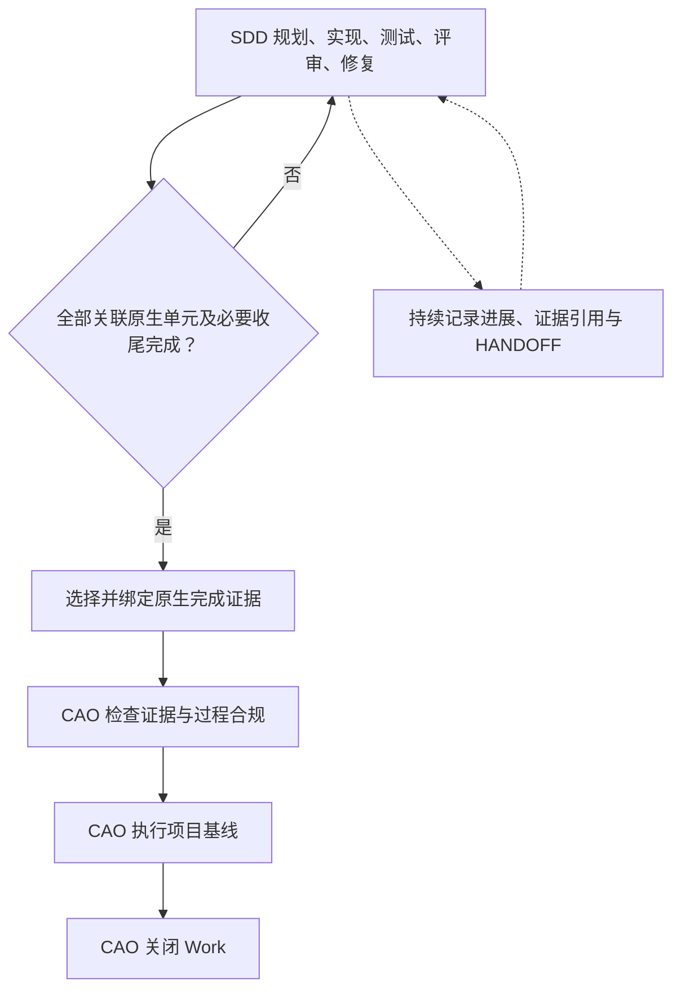
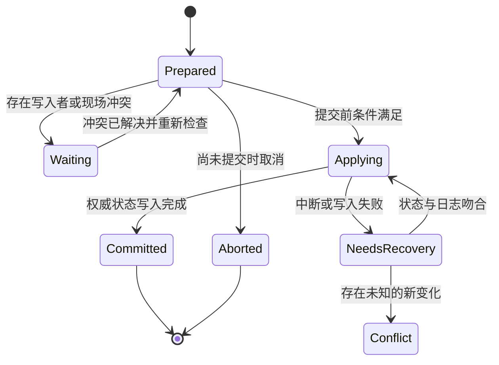

# CAO 长任务、恢复、任务切换与 SDD 证据交接优化方案

- 日期：2026-10-27
- 代码基线：`wymix-tech/coding-agent-orchestrator`，`main@223e353ea0bcf4663f56334ec16c2fae06387908`
- 已包含：PR #29，SDD/CAO 生命周期边界修复。
- 本文性质：设计与实施计划；下文标注“拟新增/拟扩展”的能力尚未实现。
- 目标：在现有生命周期契约 2 上，使长任务能够持续留下可追溯进展，主动暂停可完整交接，突然中断可诊断恢复，任务切换可在失败后继续完成，并持续保留 SDD 原生实现证据。

## 1. 最新 main 的实际基础与剩余缺口

本方案以本次获取的提交为准，不沿用此前 `c9b98e2` 的全部缺口判断。PR #29 已解决的能力应复用，不能重新搭建或逆转。

| 领域 | main 已实现 | 本次补齐 |
| --- | --- | --- |
| 生命周期 | 新 Work 使用契约 2；SDD 规划、实现、测试、代码评审、修复、原生验收及必要收尾均属于 CAO implementation | 在这些阶段持续记录续接点与过程证据，保持同一职责边界 |
| 原生完成证据 | `cao lifecycle bind` 绑定原始报告、哈希、Work/需求/范围/产品输入、解析观察和既有执行/评审来源 | 支持完成前的增量收集、失败和未完成结果、单元/尝试归属、历史版本与最终选择 |
| 证据失效 | 已分离 product、native_sources、native_scope、reports、native_dependencies、baseline、policy | 将失效结果带入 HANDOFF/恢复报告；保留保守的失效判断，不凭路径相似性缩小验证范围 |
| 状态可靠性 | 单文件原子写、仓库锁、state_revision、execution_generation、事件 outbox、索引恢复 | 增加跨 Work/Session/HANDOFF 的可恢复切换操作；锁本身不等于多文件事务 |
| 授权状态保护 | lifecycle guard 保存最后授权 Work；迁移/回滚已有日志及中断恢复 | 通用恢复先协调这些机制，避免再建一套互相冲突的权威备份 |
| 会话与交接 | 稳定 Session 标识、父子会话、不可变交接历史、重复快照去重 | HANDOFF 增补原生位置、证据、执行中动作、工作区指纹；建立接收与恢复记录 |
| 恢复上下文 | payload 已读最新 handoff；CLI 渲染主要展示 summary、最近决策、阻塞和下一步 | 真正展示有效 completed/pending、最新交接、当前原生单元和未决运行；明确分页与缺失信息 |
| 运行中断 | 可区分 orphaned_start、result_uncommitted、outcome_unknown、superseded 等；不会自动把诊断当通过 | 提供统一恢复计划、有限处置及“无需重跑/必须复核/可安全重试”的可解释分流 |
| 任务切换 | `start --replace` 先验证目标，再挂起旧 Work、写交接、激活新 Work；延迟工具结果归原任务 | 用户意图分流、todo 入队、相同任务恢复、切换事务、旧写入者收束和工作区漂移检查 |

经代码确认的具体不足：

1. `cmd_checkpoint()` 的 completed/pending 是追加文本；没有完成、取消、替代待办的统一操作。
2. `create_handoff()` 的版本 1 记录没有完整的 SDD 单元位置、原生完成证据、输入域指纹和未决执行清单。
3. `render_context()` 没有把 payload 中最新 handoff 和 completed/pending 完整传递给模型；suspended Work 主要返回 intake 指引，缺少充分的只读预览。
4. `lifecycle bind` 要求原生完成前置条件满足，适合最终验收绑定；不能直接承担长任务中失败、部分完成证据的收集职责。
5. 当前 bind 每次构建整组 reports/gates；历史会保留，但新的调用不是逐条追加。后续增量收集必须避免遗漏旧报告或意外扩大覆盖。
6. `start --replace` 分别写旧 Work、交接、新 Work、Session；这些文件之间没有统一的切换提交记录。
7. `runtime recover --check` 是诊断检查，并会尽力追加观察事件；它不是执行恢复，也不是完全零写入的 dry-run。
8. `_prepare_start()` 会调用 `reset_requirement()`；实际需求哈希改变时会重置相应规划/绑定。因此恢复和切换不能借用 start 路径隐式接纳需求变化。

## 2. 设计原则与责任边界

### 2.1 保持契约 2 的生命周期



- SDD 决定原生任务拆分、开发进度、功能测试、代码评审与任务验收。
- CAO 决定 Work 身份、任务切换、授权范围、证据关联、新鲜度、项目基线和最终关闭资格。
- HANDOFF 是某一时刻的恢复快照；运行日志是执行观察；两者都不能直接授予门禁。
- 已完成的部分原生单元不使整个 Work 提前进入 CAO review；任何 checkpoint 也不得伪造 SDD done。
- 不增加第二套功能验收 executor，不要求把原生 Markdown 报告重新写成 JSON，不重复进行功能代码评审。
- 项目背景、骨架和验证基线仍先于业务 Work；缺失项目准备时，恢复只暴露项目准备上下文和最小 Work 标识。

### 2.2 三种状态必须分开

| 状态 | 权威来源 | 典型值 |
| --- | --- | --- |
| Work 生命周期 | 经保护的 Work 记录 | todo / active / suspended / completed |
| 原生执行进度 | 绑定的 SDD 任务、SPEC、story/change/feature、评审记录 | pending / in_progress / in_review / done / unknown |
| 连续性与恢复情况 | 运行事实、HANDOFF、恢复/切换操作 | resumable / reconciling / waiting_run / needs_resolution |

连续性状态通过独立字段或派生视图表达，不把所有恢复问题都塞进 Work.status。原生 in_review 继续属于 CAO implementation。

### 2.3 一个事实只维护一个权威来源

原生任务进度由 SDD 文件维护；CAO 只保存带来源指纹的观察与绑定。交接中的“待办”分为原生未完成单元的实时投影，以及真正属于 CAO 协调的事项，例如补齐报告引用、处理运行结果未知、补充已决定但未记录的上下文。不能建立另一套要求模型同步维护的 story/task 状态。

## 3. 统一连续性视图

拟新增 `continuity_view(repo, work)`，复用现有 completion、native progress、evidence domains、runtime 和 Session 查询，提供同一份结构化结果给 `resume`、`next`、Host 上下文、HANDOFF 和 dashboard。

返回内容：

- 当前 Work/需求版本、项目绑定、生命周期契约和状态版本。
- 当前 SDD provider、安装版本/技能指纹、路线、关联范围和原生观察状态。
- 当前原生单元、最后可核验动作、最小下一步；没有可靠来源时标记 unknown。
- 有效已完成单元、未完成单元、被重开/缺失/新增的单元；总量与分页游标。
- 当前有效决策及其原始依据；被 supersede 的决策只进入历史。
- 过程证据、完成证据、conformance、项目基线分别显示，不能混成一个 passed。
- 活跃/结果未知的 run、子代理、待处理操作和写入权限归属。
- 最新交接与其后发生的变化、检查点覆盖程度、可立即执行的恢复动作。

顺序优先级固定为：状态完整性与未完成事务 → 项目/Host 必要前置条件 → 写入者和运行冲突 → 来源/输入漂移 → SDD 剩余工作 → 完成证据缺口 → conformance → 项目基线 → done。

所有新动作通过现有动作解析入口返回，避免 `resume`、`next`、Host 和 dashboard 各自判断流程。已有 `lifecycle_contract.next_action()` 保留完成资格权威；连续性层只能增加前置恢复动作，不能降低其要求。

## 4. 长任务进展与检查点

### 4.1 原生单元的稳定引用

复用 `cao_plans.py`、`native_progress.py`、已绑定 plan_scope 和路线信息，统一原生单元引用：

`provider + artifact_root + native_unit_id + scope_revision`

| Provider/路径 | 单元定位 | 边界要求 |
| --- | --- | --- |
| BMAD 标准路线 | 显式绑定的 epic/story key 和计划文件 | 只读当前 Work 关联单元；保留已知 story，删除不能缩减范围；epic 新增 story 必须被发现 |
| BMAD light/oneshot/dispatch | 实际 SPEC 和其稳定任务标识；不足时只定位到 SPEC/阶段 | 不为 light 凭空创建 sprint 或正式 planning stage |
| OpenSpec | change 根目录与任务标识，关联已确认的归档迁移 | 多 change 聚合；归档迁移不视为新任务，也不能随意选另一同名文件 |
| Spec Kit | feature 根目录和实际 task ID | 无稳定 ID 时保留来源/章节/描述指纹；重排或重复文本出现歧义时要求重新绑定 |

行号仅作为定位提示，不能作为身份。对于缺乏 ID 的原生列表，可以由 CAO sidecar 分配观察 ID，但重新匹配必须唯一且可解释，不改写原生格式、不用模糊相似度自动确认同一任务。

### 4.2 结构化协调事项

拟为现有 checkpoint 扩展协调事项记录，字段包括：`id`、`kind`、`summary`、`status`、`source_ref`、`created_at`、`resolved_at`、`supersedes`。状态为 open/resolved/cancelled/superseded。

- 原生任务完成由 provider 观察确认；Agent 自述显示为声明，不能改写任务完成资格。
- `--completed/--pending` 保持兼容，转换为带 `legacy_note` 来源的记录，不推断它与某个原生任务一一对应。
- 新增事项通过 CLI 参数录入，完成/取消通过 ID 操作；Agent 无需手写内部 JSON。
- 修改一个说明、解决一个待办只更新连续性记录，不使有效功能证据无理由失效。

### 4.3 自动观察与语义检查点

| 触发点 | 自动保存 | Agent 需要补充 |
| --- | --- | --- |
| 原生单元开始或切换 | 单元引用、来源哈希、会话与尝试 ID | 当前目的与具体下一步 |
| 原生任务/评审状态变化 | 变化前后观察、引用和时间 | 新决策、未写入原生产物的注意事项 |
| 构建/测试/评审完成或失败 | 已存在的 run/报告引用、明确结果 | 必要的失败解释；不能把声明伪装成执行事实 |
| 主动暂停、切换、结束 | 强制生成或复用最新 HANDOFF | 如上下文存在未落盘内容，先补语义摘要 |
| Host 上下文压缩前 | 能力支持时生成快照和续接索引 | 当前文件内尚未完成的动作 |
| 突然崩溃后 | 恢复时重建已存在的事实 | 无法还原的信息标为 unknown |

不在每次工具调用后扫描整个仓库。工具事件只更新轻量变化标记；阶段边界、显式 checkpoint、恢复和最终绑定时进行必要指纹核对。快照前后检查输入是否稳定；发现变化时标记不一致，不生成看似完整的证据。

检查点新鲜度以“最近一次重要执行/输入变更是否已被覆盖”为主；时间仅用于提醒。无执行变化的长时间等待不能自动使检查点或验收证据失效。提示按状态指纹去重，连续提醒不反复触发整轮 Agent。

## 5. SDD 过程证据与最终完成证据

### 5.1 分阶段采集，同一条证据链

拟新增过程证据登记接口，并复用现有原生解析器、artifact/path 保护、runtime outbox 和 lifecycle bind：

1. 规划产物、实现说明、测试输出、评审报告、修复记录、原生 HANDOFF 在产生时登记引用。
2. 登记允许 failed、partial、interrupted、unknown；它只说明某份产物存在及其观察结果。
3. 最终原生范围完成后，选取有效过程证据作为 completion manifest 的候选。
4. `lifecycle bind` 继续严格检查成功报告、身份/输入/范围/依赖、原生义务和新鲜度，生成正式完成绑定。
5. CAO conformance 检查证据链，verify 只执行项目基线。

### 5.2 每条证据的最低结构

| 字段组 | 内容 |
| --- | --- |
| 身份 | evidence_id、work_id、provider、schema_version、kind |
| 原生范围 | route_ref、unit_refs、scope_revision；工作级报告明确标为 work_scope |
| 文件 | provider 原始路径、内容哈希、格式、可选稳定 selector、归档迁移引用 |
| 执行 | attempt_id、run_id 或真实工具调用 ID、Session/父 Session、开始/结束时间；未知就留空 |
| 输入 | requirement/scope/product/dependencies 指纹、指纹采集时间和采集来源 |
| 来源类型 | executor_receipt / correlated_host_observation / provider_artifact / agent_declaration |
| 结果 | observed_outcome、解析器 ID/版本、原始退出信息、未决事项 |
| 关联 | supersedes、derived_from、review_ticket_ref、fix_ref、验证目标引用 |
| 当前适用性 | 派生的 fresh/stale/missing/conflicting/unknown，及具体原因 |

关键限制：

- 绑定时取得的当前代码指纹，不能被追认成“执行开始时的代码指纹”。缺少开始时记录就明确来源限制。
- 哈希证明内容未变，不能证明报告内容真实；退出码也不能单独证明功能满足需求。
- Host 只观察到执行动作时，标为 observation，不能宣称 CAO 已控制进程或拿到完整回执。
- SDD 的实现说明可以没有逐项结构化断言；CAO 不要求额外生成一套功能验收映射。
- 风险 gate 与实际报告覆盖建立显式关联。一个工作级报告可以覆盖多单元，但不能仅凭文件存在或 Agent 随意标签自动扩展覆盖。

### 5.3 原格式、版本与历史

- provider 原始报告继续保存在 provider 自己的输出目录；CAO 保存结构化引用及观察，不要求转换报告。
- 同一 evidence_id 的内容不可覆盖；报告变化创建新证据记录，并显式 supersede 原记录。
- 优先使用原生按 attempt/version 分文件的产物。确实会覆盖的原始报告，可选择已有 Git blob 或受控的内容快照保存历史字节；快照属于历史证据副本，不成为新的原生任务源。
- 仅保存 hash 而原文件已被覆盖时，历史应标记 `historical_content_unavailable`，不能声称能够重现旧报告。
- 日志清理保留当前正式引用、活跃恢复/切换操作依赖、必要元数据；可清理的正文应留下删除标记。当前门禁依赖的正文不允许被普通 prune 删除。
- 普通业务源码不因做 HANDOFF 而复制进 runtime；用仓库引用、清单和内容指纹描述工作区。

### 5.4 完成证据增量与历史执行

拟提供“登记证据”和“最终绑定”两个动作，避免把每次原生测试输出都调用严格完成 bind：

```bash
# 拟新增：可在实现期间调用，unit/evidence ID 由查询命令返回
cao evidence attach --work <id> --unit <unit-ref> --kind test --path <native-report>
cao evidence list --work <id> --unit <unit-ref>

# 已有接口保留：仍传入本轮完整报告集合
cao lifecycle bind --work <id> --report <report-a> --report <report-b>

# 拟扩展：从登记记录显式选择最终证据，不能自动选“最新成功”掩盖后续失败
cao lifecycle bind --work <id> --evidence <evidence-id> --evidence <evidence-id>
```

同一相关输入上先成功、后失败的执行，失败未解决时不能选旧成功报告完成。不同尝试之间只复用实际仍有效的来源；恢复不通过重复绑定把旧失败抹掉。重复 attach/bind 在相同内容、范围、来源下幂等。

保持现有证据域划分：报告改动通常要求重解析/重绑，不自动要求重新执行未受影响的项目基线；产品输入改变按现有保守规则失效。若未来引入单元级最小重验，必须先证明依赖范围完整，本期不以文件路径不相交作为充分依据。

## 6. HANDOFF v2 与恢复上下文

### 6.1 HANDOFF 是可核验的交接快照

继续使用 `.orchestrator/handoffs/<work-id>/<handoff-id>.json`，升级为 v2。保留 v1 读取能力，所有写入走受控 CLI/Host 路径。

| 内容 | 具体要求 |
| --- | --- |
| 快照身份 | handoff_id、sequence、work_id、state_revision、execution_generation、continuity_revision、原因与时间 |
| 需求与项目 | 当前需求版本/哈希、scope、项目背景及基线引用；不复制全部项目文档 |
| 双层阶段 | CAO 阶段 + SDD 原生阶段；例如 implementation + in_review |
| 原生续接点 | provider/version/route、原生单元引用、已完成与未完成观察、当前尝试、下一项原生动作 |
| 实现现场 | 必须先读的文件/章节、改动清单、未完成编辑说明、已有测试结果、正在等待的输入 |
| 证据包 | 过程证据索引、正式完成绑定引用、评审票据/修复关系、conformance/基线状态及其输入指纹 |
| 未决运行 | run/工具调用/子代理标识、owner、运行/退出/结果未知、允许的下一步处置 |
| 工作区 | Git 可用性、HEAD/branch、产品快照、脏文件清单、非 Git 情况、外部状态是否已知 |
| 决策与待办 | 有效决策引用、结构化协调事项、阻塞原因；原生 pending 由实际计划观察生成 |
| 可恢复性 | capture_complete、缺失来源/信息、快照后变化、safe_next_action、禁止直接重放的动作 |

快照中没有证据支持的步骤不得写成“已完成”；失败创建 HANDOFF 时，原任务不能被静默标记为已成功交接。

### 6.2 人读摘要与模型上下文

同一数据源渲染两种视图：

- 用户摘要：任务、SDD 当前单元、进展、阻塞、下一步，通常 5–8 行。
- 模型恢复上下文：必读的原生来源、完整关键阻塞、未决执行、有效待办、交接变化和继续命令。

大型范围不把所有历史日志塞回上下文：包含总量、当前单元、关键待办、未展示数量和可查询索引。安全相关的未决运行及漂移告警不得截断；正文详情分页按需读取。模型短视图不能以“已省略”为由遗漏必要恢复检查。

### 6.3 接收记录与语义边界

新增独立的 HANDOFF 接收/恢复记录，包含接收 Session、原 handoff_id、当时的当前状态指纹、差异摘要、选择的续接动作。它证明恢复流程已读取并检查这些事实，不证明模型理解，也不授予完成资格。

HANDOFF 永远不覆盖当前 Work。恢复时若 Work/原生文件比交接更新，以当前受信状态为准，展示交接后的差异；交接仅作历史说明。取消或替代待办不能依赖旧交接把它重新打开。

### 6.4 子代理与宿主适配

- 子代理返回原生报告路径、真实票据/尝试标识和已知执行结果；没有 shell 的子代理由主 Agent 代为 attach，来源仍标识为该子代理。
- 迟到报告和工具结果绑定原 Work、原尝试和原 generation；可登记为历史，但不能取得新任务/新 generation 的执行授权。
- Host 支持压缩/切换事件时接入相应真实事件；不假设所有 Host 都有相同 hook。
- Host 不支持事件时在显式 checkpoint、handoff、resume 和已有 stop/turn_end 事件兜底，并报告能力覆盖程度。
- 不虚构 Session ID；缺少宿主原生标识时可做不绑定会话的只读查询，不把随机 ID 宣称为真实会话。

## 7. 任务中断恢复协议

### 7.1 统一入口与分层处置

拟扩展 `cao resume`：默认先计算恢复计划，再执行已授权且确定性的元数据恢复，最后输出当前可执行动作。提供 `--check` 只读预览；suspended Work 的预览不激活、不绑定新执行 Session、不改变原生状态。

恢复顺序：

1. **核对权威状态。** 检查 lifecycle guard、Work revision、未完成的迁移/切换操作。损坏或未知写入先进入现有隔离恢复流程。
2. **核对必要前置条件。** 检查 Host 安装/重启、provider 和项目准备。缺失时保留原 Work，输出项目准备所需最小信息。
3. **核对执行者。** 检查 run owner、原主会话/子代理、未完成工具动作。近期活动或 PID 存在均不是足够的控制权证明。
4. **核对现场。** 比较 HANDOFF 与当前需求、scope、provider、产品、原生来源/报告、基线和工作区指纹。
5. **核对原生进度。** 只读观察绑定的 SDD 范围，列出仍完成、已重开、新增、缺失及无法识别的单元。
6. **形成恢复计划。** 输出已知事实、未知事项、仍有效证据、失效证据、最小下一步及其必要前置条件。
7. **提交恢复记录。** 完成必要元数据修复与显式激活/会话接收；业务执行由宿主 Agent 按当前动作继续。

`--check` 的新实现必须保证零业务状态写入；不得调用会迁移路径、修复 guard 或 drain outbox 的现有便捷读取函数。使用严格的只读快照接口。普通 resume 可以有确定性恢复写入，但必须返回实际发生的恢复动作。

### 7.2 按运行事实分流

| 中断现场 | 恢复策略 | 不得发生 |
| --- | --- | --- |
| 正常暂停，文件和原生状态未变 | 展示最新续接点，显式恢复 suspended Work 后继续 | 重跑 intake、重新问已确认技术选择 |
| 宿主关闭，但受控命令仍运行 | 等待/重新附着到可验证的同一 run；只读观察 | 同时启动相同命令 |
| owner 已退出，完整回执已提交 | 复用已入账事实，继续后续原生步骤 | 把同一次执行再登记一遍 |
| 回执已落盘、正式结果未提交 | 检查原运行身份、完整命令集合、结束状态、generation 和输入；满足条件才由专用 finalize 恢复提交 | 仅凭零退出码或 result.json 投影批准门禁 |
| 有启动记录，无完整回执 | 标记 outcome_unknown，核验进程、文件及外部副作用，决定是否新建尝试 | 默认成功、默认失败或无条件重放 |
| 子代理完成但未 attach | 从真实子会话/票据找回产物，由主 Agent 代为登记并保留来源 | 编造子代理执行能力或主会话来源 |
| 旧 generation 的迟到结果 | 收入原尝试的历史，当前资格保持不变 | 覆盖新 run、解除新阻塞或给新 Work 授权 |
| 产品/需求/范围已变化 | 列明 changed_domains/paths 和受影响证据，执行原有 reanchor/原生修复流程 | 将当前哈希追认为旧执行输入 |
| 仅基线 wrapper 改变 | 按现有基线变更审批和验证流程处理；检查是否同时是原生声明依赖 | 无依据地重启全部 SDD 评审 |
| 原生任务源消失/出现身份歧义 | 精确定位待恢复来源，允许只读调查和受控修复 | 猜测另一任务文件、删除旧绑定来绕过范围 |
| provider/技能版本变化 | 展示版本差异，保留已有原始报告；必要时显式重解析或迁移 | 默默用新适配器把旧证据升级为通过 |
| 发现状态损坏或不支持 writer | 复用 lifecycle recover，保留异常原始字节和审计 | 用旧 handoff 覆盖最新受信状态 |

### 7.3 可恢复提交与安全重试

“回执未入账”的恢复只针对已经完成且输入明确的同一次受控执行。finalize 必须复用正常结果提交的校验器，并检查完整运行清单、run_id、Work、generation、输入指纹和结果哈希。任一项缺失时返回诊断，不重跑、不批准。

重试分类以命令适配器/明确声明及实际副作用边界为依据：

- read_only：可重新观察。
- repeatable_local：经验证可重复的本地构建/测试，以新 attempt 执行；仍检查资源占用及工作区状态。
- external_or_unknown：外部修改或副作用未知，先检查目标系统状态及已有幂等键，必要时请求明确处置。

不能仅凭命令名含 test/build 判断无副作用。`runtime recover` 继续保持诊断含义；拟新增的 finalize 必须使用明确子命令并返回重新确认的条件。

重复恢复失败的收敛签名包含：原因、Work/generation、输入指纹、待处理操作和来源证据。相同签名连续失败只返回稳定诊断，修正输入后再允许新尝试；普通重复查看不计失败次数。复用现有 completion repair 的理念，避免把所有失败原因统一锁死。

## 8. 新消息、待办与需求变更

### 8.1 先识别消息意图

| 用户消息 | 默认处理 |
| --- | --- |
| “继续”“刚才中断了” | 恢复当前/明确指定 Work；无唯一对象时列出候选 |
| 查询状态、解释现有实现、纠正表达 | 回答或补充当前上下文，不自动创建需求 |
| 当前目标内的明确修正 | 更新已有决策/范围说明；涉及真实需求或验收改变时进入显式 amend |
| “先暂停 A，做 B” | 已明确选择切换，直接准备切换，无须再次问是否切换 |
| “这个先记下来” | 登记 todo，当前 Work 继续 |
| 新需求但优先级与关系不清 | 给出暂停切换 / 记录 todo / 相关时并入当前三种选择 |

意图分类由 Agent 理解上下文；CAO 验证结构化执行选择及其证据。不能用简单关键词匹配自动修改需求或切换 Work。“强相关”只决定是否提出合并建议，不能授权任意扩大当前任务。

Host 已有 prompt 原文可作为请求来源引用；没有 hook 时由主 Agent 记录用户原话并标记来源受限。普通提问和“继续”不应进入需求队列。请求的重放通过宿主消息 ID/显式 request_id 去重，不把相同文字永久视为同一个请求。

### 8.2 待办登记不占用 active 槽位

拟扩展 `cao start --defer`，生成 status=todo 的 Work，保存需求文档、请求来源、初步关联和创建时间；不执行 provider inspect、路径评估、业务实现或基线验证。缺少项目准备可以登记待办，激活时再检查所有前置条件。

`cao list --status todo|active|suspended|completed` 展示实际 Work 状态；`cao requirement list` 增加关联 Work/status 和未入队标记，避免需求文件与 Work 列表互相矛盾。todo 与 suspended 区分：前者从未开始执行，后者保留实际执行现场。

首次激活 todo 时建立真实项目绑定和执行基线，不能把排队日期的文件树当成开发起点。重复 start/defer 不覆盖已有 Work，已完成 Work 仍需显式 reopen。

### 8.3 合并到当前需求必须保留变更边界

拟新增 amend 的 preview/apply：

1. 先记录新请求与旧需求的关系、拟修改内容和验收影响。
2. preview 显示需求差异、SDD 范围影响、需要重新规划/执行的事项和受影响证据。
3. apply 使用期望的需求/Work 版本，保留旧文档版本和变更记录，调用现有 reanchor/失效流程。
4. 保留 Work 身份和实际完成历史；确需回到原生规划时说明原因，不能悄悄全量清空。
5. 若没有发生实际需求文件改变，仅是恢复或解释，不调用 reset_requirement。

不新增绕过既有变更确认的 `--force`。用户已经明确授权的具体修改可直接执行；不明确的范围扩展才需要选择。

## 9. 可恢复的任务切换

### 9.1 原子性的准确边界

目标是“切换操作可以恢复完成，业务授权不会落在半切换状态”。文件系统上的多个文件无法靠现有原子 replace 一次提交；需要操作日志、确定的提交点和恢复规则。

每个切换操作具有稳定 operation_id，记录 from/to Work、触发请求、期望 revision/generation、HANDOFF、工作区指纹、Session 变更、受影响 run、步骤进度和最终结果。



### 9.2 执行步骤

1. **只读预检。** 校验目标存在、身份正确、项目/Host/provider 前置条件，确认 source 未漂移；目标需求已改变时返回差异，不经 start 偷偷重置。
2. **登记切换意图。** 在仓库锁下保存操作日志及期望 revision；通过共享的操作入口阻止源/目标 Work 新的业务写授权，仍允许诊断、收集回执与完成当前受控动作。此时 source 仍为原 active。
3. **收束执行。** 等待可验证的写入 run 完成，或通过支持的受控取消接口停止；外部/不受控进程无法证明终止时停在 waiting，不谎报安全切换。
4. **保存现场。** 刷新原生观察、过程证据、检查点和 HANDOFF v2。归集期间允许产生新 revision，随后重新校验并将最终切换前映像固定在日志中。
5. **提交切换。** 持仓库锁验证最终前置条件，按固定顺序挂起 source、激活 target、更新发起者 Session 与执行代次、记录切换提交点。每次 Work 写入仍走现有 guard/save_work；索引和 UI 是可重建投影。
6. **恢复目标上下文。** 运行目标恢复计划、建立接收记录，再放行业务写授权。仅迁移发起切换的主 Session；其他旧会话和子代理保持原绑定，其旧写入权限失效。

不在持仓库锁时等待长命令、询问用户、调用 provider 或执行 Git 网络操作。日志/WORK/SESSION 中途不一致时，普通读取返回 transition_pending 的最小诊断；业务写入必须先恢复未完成操作。未完成切换的目的只由日志决定，不能因为暂时没有 active Work 就创建新任务。

### 9.3 崩溃恢复与幂等

- prepared 尚未提交时，可以取消意图并恢复正常授权；不改写产品文件。
- applying 中断时，逐项检查实际状态等于预期 before 或 after，再继续未完成步骤。遇到既非 before 也非 after 的新变化，进入 conflict，不能覆盖。
- committed 后索引、事件或 Session 投影缺失，按原 operation_id 修复；不再生成第二次切换或重复 HANDOFF。
- 跨 Work 恢复先解决各 Work 的 prepared lifecycle guard，再处理切换日志；全局锁顺序固定，避免递归恢复和死锁。
- source→source 是恢复/查询，不是挂起再激活；反复执行同一切换请求返回同一操作结果。
- 超时/失联不能自动视为 owner 已死亡，也不能凭旧 PID 杀进程。只取消有匹配宿主、run、启动身份/进程组记录的受控进程。
- 迟到结果仍归原任务。generation fencing 能阻止旧结果被当前引擎接纳，但不能物理阻止已启动的外部进程修改文件，因此必须先收束写入者。

### 9.4 工作区策略

**首期默认：同一工作区串行切换 + 明确漂移检查。**

- source HANDOFF 记录 HEAD、产品快照、已知改动、未跟踪文件、原生来源和未决外部状态。
- 有脏文件不必一律拒绝切换；但必须确认这些变化作为 target 起点被明确携带，并保存 source 的原现场指纹。无归属或冲突文件先处理。
- B 完成后返回 A，对照 A 的旧快照报告 B 引入的变化；保持 A 的原生历史，按实际输入重新确认受影响证据。不能把“返回同一目录”视为恢复原环境。
- Git commit 若仅记录了同一文件内容，不应单凭 commit ID 改变就让全部原生证据失效；提交位置和内容指纹分别管理。
- 非 Git 项目仍支持 fingerprint/manifest 与串行切换，报告缺少可还原提交的限制。
- CAO 不自动 stash、reset、覆盖用户文件或推送代码；需要这类工作区动作时，形成独立可审查步骤并遵守已有授权。

**后续增强：可选 managed worktree。**

只有在首期切换协议通过验收后加入。必须先定义共享 control_root/repository_id 与各 workspace_id；所有 worktree 共用同一个调度权威、操作日志及锁，业务路径与 provider 路径按各 worktree 解析。不能复制 `.orchestrator` 后形成多个互不知晓的 active 指针。

首个 worktree 版本仍保持逻辑项目单活跃 Work；历史 Work 的文件视图可独立保留。并行多 Work 调度另立设计，不在本方案中顺带开放。合并/重放后仍重新计算实际产品输入，隔离本身不保证旧证据永远有效。

## 10. CLI 与兼容性设计

以下是目标接口，不代表当前 main 已支持。实现时优先扩展已有命令，具体名称可在 P0 固定，行为和验收要求不可省略。

| 接口 | 状态 | 行为 |
| --- | --- | --- |
| `cao resume --work <id> --check` | 拟扩展 | 严格只读的恢复预览，包含 suspended Work 的现场 |
| `cao resume --work <id> --reactivate` | 已有，拟增强 | 必要恢复后激活；存在其他 active 时导向统一切换 |
| `cao context --work <id>` | 已有，拟增强 | 统一连续性视图；增加 JSON/摘要/分页选项 |
| `cao checkpoint ...` | 已有，拟增强 | 自动关联原生单元/证据，支持协调事项 ID 的完成和替代 |
| `cao handoff ...` | 已有，拟增强 | 生成 v2，支持预览；读取旧版本 |
| `cao handoff accept --id <id> ...` | 拟扩展 | 记录真实接收 Session、差异和恢复结果，不授予门禁 |
| `cao evidence attach/list/show ...` | 拟新增 | 原始过程证据登记、查询和替代；不要求手写 JSON |
| `cao lifecycle bind --evidence <id> ...` | 拟扩展 | 显式选取最终报告集合，复用现有完成校验 |
| `cao start --requirement <path> --defer` | 拟扩展 | 建立 todo，当前 Work 不变，不进入业务准备/执行 |
| `cao switch --to <id> --check` | 拟新增 | 目标、写入者、工作区和证据影响预览 |
| `cao switch --to <id> --reason <text>` | 拟新增 | 执行可恢复切换，复用前置检查和用户已明确选择 |
| `cao switch recover --operation <id>` | 拟新增 | 恢复同一操作，拒绝覆盖未知变化 |
| `cao amend --work <id> --request <id> --check/--apply` | 拟新增 | 预览并应用真实需求变更，保留身份和历史 |
| `cao runtime finalize --work <id> --run <id>` | 拟新增 | 仅恢复完整受控回执的正式提交；与 runtime recover 诊断分开 |
| `cao list --status ...` / `cao requirement list` | 拟扩展 | 统一显示已入队、执行、挂起、完成与文件关联 |

兼容入口必须统一：`start --replace` 转入同一切换服务；`block --suspend` 与主动 handoff 共用保存现场路径；`resume --reactivate`、dashboard 激活按钮、Host 入口都不能绕过操作协调器。

恢复/查询/终止受控运行等命令须有精确的门禁豁免范围，保证故障时能自救；不得用任意 shell 命令白名单放开所有 `.orchestrator` 写入。

## 11. 数据布局与代码改造位置

沿用现有目录，只增加具有明确职责的记录：

| 路径 | 职责及权威边界 |
| --- | --- |
| `.orchestrator/work/<id>.json` | Work 权威状态、连续性 revision、当前证据/进度引用；避免无界嵌入历史 |
| `.orchestrator/handoffs/<id>/<handoff-id>.json` | 不可变 v1/v2 交接历史 |
| `.orchestrator/runtime/<id>/...` | 既有执行事实、观察和可重建索引；新增过程证据记录、接收记录及必要历史正文 |
| `.orchestrator/operations/<operation-id>.json` | 切换/恢复操作意图和推进日志；保留 before/after 指纹与必要快照 |
| `.orchestrator/lifecycle/...` | 继续由现有 guard、迁移、隔离恢复管理；不得复制另一套 last-authorized-state |
| provider 自己的输出目录 | 规划、任务状态、实现说明、测试/评审报告、原生 HANDOFF 的正式源文件 |

运行记录使用原始 Work ID，不再添加 `work-` 前缀。runtime/evidence 索引仍是投影；正式完成选择由受保护的 Work 绑定决定。操作日志是切换协调权威，不成为功能验收来源。

建议模块拆分：

| 现有/建议模块 | 主要改动 |
| --- | --- |
| `cao_guidance.py` + 拟新增 `continuity_view.py` | 统一查询模型与上下文渲染；读取 payload 中真正需要的交接/进度 |
| `cao_sessions.py` + 拟新增 `handoff_context.py` | v2 快照、兼容读取、接收记录、去重和界限 |
| `cao_plans.py` / `native_progress.py` | 可定位的原生单元观察；复用现有 scope 与 provider 解析 |
| 拟新增 `implementation_evidence.py` | 过程证据登记、来源/尝试/单元绑定、历史查询 |
| `lifecycle_contract.py` / `native_reports.py` / `evidence_domains.py` | 复用严格完成校验；分离“观察任意结果”和“要求成功”的接口 |
| `runtime_queries.py` / `runtime_execution.py` | 恢复诊断统一、受控回执 finalize、run owner 与取消能力声明 |
| 拟新增 `work_operations.py` / `work_switch.py` | 可恢复操作日志、幂等、提交点、切换协调；控制模块规模 |
| `cao_work_store.py` / `lifecycle_guard.py` | 共享操作屏障与版本检查；与 guard 恢复严格排序 |
| `cao_work_commands.py` / `cao_requirements.py` / `cao_cli.py` | defer/switch/amend/过滤查询；旧入口委派同一服务 |
| `cao_host_events.py`、各 Host adapter、`dashboard.py` | Session 归属、旧 generation 写入阻断、真实事件和一致 UI |
| `protocol/*.schema.json`、`references/*`、`SKILL.md` | HANDOFF/证据/操作协议、渐进式引用、命令行为与恢复说明 |

所有新增模块、schema 和 references 必须进入 wheel 与技能 release 包。维护性设计文档留在 docs，运行时只引用随包发布的 references。

## 12. 实施顺序与交付门槛

| 阶段 | 优先级 | 实施内容 | 完成标准 |
| --- | --- | --- | --- |
| P0 基线与协议 | P0 | 固定提交、增加针对缺口的回归，确定 schema/CLI/权威来源/读写边界 | 现有契约 2 测试保持通过；新增测试准确复现缺口 |
| P1 恢复上下文与 HANDOFF | P0 | 统一连续性视图、HANDOFF v2、只读预览、结构化协调事项、suspended 现场 | 换会话可定位原生单元、必读文件、有效待办与未决运行；无重复 intake |
| P2 过程证据 | P0 | 原生过程证据登记、来源/尝试/单元绑定、原格式历史、最终 manifest | 失败/部分完成能保存；最终只有满足原有原生完成资格的证据可绑定 |
| P3 中断恢复 | P0 | 统一恢复计划、完整回执 finalize、未知结果分流、generation 和恢复收敛 | 注入中断不产生假通过、重复副作用或静默丢失已提交进度 |
| P4 待办与切换 | P1 | 请求分流、defer、amend、操作日志、写入者收束、共享工作区漂移 | A→B→A 全流程可恢复；切换每个写入点崩溃均可定位并恢复 |
| P5 宿主、打包与长任务验收 | P1 | 三 Host 适配、dashboard、文档、安装包验证、长历史性能、真实会话 | 跨会话/压缩/重启/子代理返回等有可核验记录，真实与模拟测试分开报告 |
| P6 可选 worktree | P2 | 共享 control_root、工作区注册、受控隔离、恢复与合并后漂移 | 在前述协议稳定后实施；明确单活跃 Work；独立验收，不影响首期交付 |

建议 P0–P5 为本轮完整范围，P6 为明确后续增强。P1 可先交付短周期价值，但不能用“可看到 HANDOFF”替代 P3/P4 的可靠性验收。每阶段使用可独立审阅的提交与验收记录；不得把方案测试结果写成实现后的测试结果。

实施前若 main 再变化，先对本基线做差异检查，保留新修复并更新计划；不要把旧目录覆盖到最新主分支。

## 13. 验收矩阵

以下均为实现后的目标验收，不能以当前 main 的回归通过代替。

| 编号 | 场景 | 必须满足 |
| --- | --- | --- |
| C01 | 长任务完成一部分 story，换全新会话 | 原 Work/原生单元定位正确，已完成内容保留，继续未完成范围 |
| C02 | 长任务经历多次上下文压缩 | 关键决策/当前单元/未决动作可恢复；上下文提示有界且去重 |
| C03 | pending 已完成或取消后再次恢复 | 不重新出现旧待办；历史仍可查看 |
| C04 | 原生 checkbox 重排/重复文本/任务重命名 | 不用行号误认身份；有歧义时明确要求重新绑定 |
| C05 | BMAD 单 story done，其余未完成 | CAO 仍在 implementation，不进入自身评审/验证 |
| C06 | BMAD in_review 或修复循环 | 保留原生票据与实际下一步，CAO 不重复功能评审 |
| C07 | light/oneshot 无正式任务表 | 按实际产物续接，不制造 sprint/Tasks 表 |
| C08 | OpenSpec 多 change、Spec Kit 多 feature | 仅聚合本 Work 关联范围；任一未完成不能关闭 |
| C09 | 原生文件归档迁移或共享计划新增 story | 迁移维持身份；新增范围被发现；删除不得减免已知任务 |
| C10 | 测试失败、评审未完成、过程报告不识别 | 可保留证据和 unknown/failed 结果；不能获得完成资格 |
| C11 | 原始报告为 Markdown/JSON/YAML/日志 | 保留原格式；登记与成功判断区分；无需手写 JSON 转换 |
| C12 | 原生报告被覆盖或删除 | 旧版本存在则可查；不存在则明确缺失，不把新内容算旧证据 |
| C13 | 先成功后出现相关失败 | 不挑选旧成功掩盖未解决失败 |
| C14 | 绑定时才取得当前 product snapshot | 不伪称它是执行开始时的输入；记录来源限制 |
| C15 | HANDOFF v1/v2 混合 | 旧记录可读、字段缺失显式标记，新记录完整且不可变 |
| C16 | HANDOFF 比 Work 老，或从另一 Work 传入 | 当前受信状态优先；跨任务接收被拒绝 |
| C17 | resume --check / switch --check | 业务状态、guard、outbox、Session、原生文件哈希全部不变 |
| C18 | 正常退出后用同一或新 Host 会话恢复 | 真实 Session 归属正确，无重复选择技术栈/重新建 Work |
| C19 | 强杀主进程，子进程仍执行 | 不重复启动；报告运行/未知，不能因主进程退出就判断副作用结束 |
| C20 | 命令开始后、回执前强杀 | outcome_unknown；无自动通过和无条件重放 |
| C21 | 完整回执落盘后、正式提交前强杀 | 满足条件可 finalize 同一 run；条件不足保持待决 |
| C22 | 仅 result.json 存在或被伪造 | 不授予任何正式通过 |
| C23 | generation 已变化后旧结果返回 | 只归档原尝试，不更新当前授权/验证 |
| C24 | 无 shell 子代理返回真实报告 | 主 Agent 可代 attach，身份/票据/原 Work 保留 |
| C25 | 恢复时产品、scope、provider 或依赖变化 | 给出具体差异和所需动作；不静默重置为新 intake |
| C26 | 仅基线传输变化 / 仅报告变化 | 按已有域规则失效，不无依据重跑所有原生评审 |
| C27 | 已完成 Work 读取/迁移/恢复 | 历史冻结；变更当前输入资格必须显式 reopen |
| C28 | 执行 A 时登记 B 为 todo | A、活动指针、当前 Session、项目基线保持原行为，B 不开始执行 |
| C29 | A 中用户询问状态或说“继续” | 不创建 B、不把需求文本改写成新版本 |
| C30 | A 中用户明确“先做 B” | 直接执行已选择的切换流程，不再次索要同一选择 |
| C31 | 新需求关系/优先级不明 | 展示三个选项；选 todo 后当前任务可继续 |
| C32 | amend 预览与实际 apply 之间发生新修改 | 版本冲突可见；不覆盖新需求，不丢原有进度 |
| C33 | 目标任务不合法/前置条件未满足 | 原任务不会被提前挂起，不产生已完成切换的虚假记录 |
| C34 | 切换每一次持久化前后强杀 | 恢复同一 operation；业务写授权不落在半切换状态 |
| C35 | 重复调用切换、反复 A→B→A、A→A | 幂等，单活跃约束成立；原记录/证据无丢失 |
| C36 | 两主会话并发切换、子代理迟到写入 | 只有合法操作推进；旧写入请求被阻断，历史结果归属不串 |
| C37 | A 未提交，B 修改同文件，再恢复 A | 漂移和冲突明确；不自动 stash/reset，不沿用失效证据 |
| C38 | 已受控 run 取消、PID 重用、远端 owner 未知 | 仅取消正确进程；不能确认时等待/阻塞，不能误杀 |
| C39 | guard prepared 与 switch applying 同时遗留 | 按固定顺序恢复，避免递归/覆盖/双 active |
| C40 | 日志配额满、历史大、prune 中断 | 关键恢复引用和正式证据不丢；可选日志失败不篡改门禁 |
| C41 | 同一内容仅做 Git commit | 分开报告提交位置变化和内容变化，不一律撤销全部证据 |
| C42 | 非 Git 项目 | 能用快照/清单恢复与串行切换；不声称可自动还原文件树 |
| C43 | 三 Host、三 provider、三路线覆盖 | 使用支持的实际组合；不支持的组合注明，不能由一个 BMAD 测试推断全部兼容 |
| C44 | wheel/release 安装后执行 | 新模块/schema/reference/CLI 在源码目录之外可用 |
| C45 | 真实 Pi + 实际模型 + 安装 provider 会话 | 完成跨会话续接、中断、A→B→A，并保留主/子会话与命令证据；模拟测试不得冒充 |

测试方法：

- 通过子进程退出/强杀、磁盘写入失败、原子替换前后故障注入，覆盖真实持久化边界；不要只 mock 最外层返回值。
- 并发测试检查最终权威文件、guard、操作日志、Session、事件和实际产品文件，不只断言 CLI 返回码。
- 对外部副作用使用可记录幂等键和调用次数的测试服务，验证不会无条件重放。
- 设计长历史样本：至少 1,000 个原生单元、10,000 条观察、1,000 次交接和多次输入变化；测量 p50/p95、内存、上下文大小、磁盘增长。
- 性能验收以同环境现有实现为对照；常规事件处理不得线性扫描全部历史，输出分页和预算有界，报告实际数据而非预先承诺固定秒数。
- 新功能涉及当前安全边界，必须跑相关定向回归、全量 Python、Pi adapter/type check、安装矩阵及发布裁剪检查。

## 14. 迁移、发布与已知边界

### 14.1 兼容迁移

- 不因引入连续性记录而升级 lifecycle_contract 到 3；连续性、HANDOFF 和证据使用各自 schema version。
- 契约 1 Work 保留原有执行协议，只增强可读交接/观察；迁移到契约 2 仍通过已有 lifecycle migrate，不能因 resume 自动改变。
- v1 HANDOFF、legacy 文本清单按原意展示，不虚构其缺失的执行身份和证据。
- completed Work 的历史不会因补齐字段而变成新的当前通过结果。
- 新 reader/writer 需要显式能力版本与操作屏障支持；不支持切换协议的旧 writer 禁止继续写入已启用新协议的项目。现有 guard 能检测部分未知写入，但不应宣称它可物理阻挡旧进程。
- 保留未启用新功能的读取兼容；遇到未完成操作或新格式权威写入时不能静默忽略。

### 14.2 用户可见体验

用户说“继续”时，预期回复类似：

> 已恢复 Work A。原生流程仍在实现阶段：story 2.3 已完成，2.4 的代码已写入，测试结果尚未确认。上次运行进程已退出但缺少完整回执；先检查该次测试产物，再继续 2.4。已确认的技术栈和已完成评审保持记录。

用户说“先暂停 A，做 B”时，预期行为是保存 A 的真实现场、处理未结束动作、完成切换并进入 B；回到 A 时明确指出 B 引入的输入变化。确认信息只用于尚不明确的优先级/范围或无法安全判断的外部副作用。

### 14.3 不承诺的能力边界

本方案不保证在任意时刻强杀后精确恢复 CPU/编辑器内存中的执行位置；未落盘且无宿主记录的信息只能标未知。CAO 也不能通过元数据锁阻止任意外部程序写产品文件。目标是已持久化事实不丢、未知结果不冒充成功、重复副作用受控、恢复动作清晰且可追溯。

真实模型会话验收依赖可用的宿主和模型登录。仓库现有 PR #29 验收记录明确说明其真实模型会话仍未完成；本轮方案也不能将本地 CLI/fixture 测试写成真实端到端成功。

## 15. 本轮设计核对与代码索引

本轮只设计方案，未修改仓库源码。交付前再次获取远端 main，仍为 `223e353ea0bcf4663f56334ec16c2fae06387908`。

本次在该提交上运行 7 个相关测试模块，共 **82 项通过**，耗时约 79.9 秒：`test_sessions`、`test_handoffs`、`test_runtime_recovery`、`test_runtime_host`、`test_state_transactions`、`test_native_lifecycle_contract`、`test_lifecycle_integrity`。

执行命令：

```bash
PYTHONPATH=.:tests python -m unittest \
  tests.test_sessions tests.test_handoffs \
  tests.test_runtime_recovery tests.test_runtime_host \
  tests.test_state_transactions \
  tests.test_native_lifecycle_contract tests.test_lifecycle_integrity
```

这些结果验证设计所依赖的 main 基础，不代表本方案新增能力已实现。本次未运行全量套件或真实模型长任务会话，不能据此宣称新增恢复/切换协议已通过端到端验收。

代码证据均固定到本方案提交：

- [生命周期职责及原生报告绑定](https://github.com/wymix-tech/coding-agent-orchestrator/blob/223e353ea0bcf4663f56334ec16c2fae06387908/references/native-lifecycle.md)
- [恢复 payload 与实际上下文渲染](https://github.com/wymix-tech/coding-agent-orchestrator/blob/223e353ea0bcf4663f56334ec16c2fae06387908/scripts/cao_guidance.py#L24)
- [HANDOFF v1 与快照去重](https://github.com/wymix-tech/coding-agent-orchestrator/blob/223e353ea0bcf4663f56334ec16c2fae06387908/scripts/cao_sessions.py#L399)
- [start、checkpoint、resume 与切换写入顺序](https://github.com/wymix-tech/coding-agent-orchestrator/blob/223e353ea0bcf4663f56334ec16c2fae06387908/scripts/cao_work_commands.py#L79)
- [原生范围与任务观察](https://github.com/wymix-tech/coding-agent-orchestrator/blob/223e353ea0bcf4663f56334ec16c2fae06387908/scripts/cao_plans.py)
- [完成证据约束和整组报告绑定](https://github.com/wymix-tech/coding-agent-orchestrator/blob/223e353ea0bcf4663f56334ec16c2fae06387908/scripts/lifecycle_contract.py#L163)
- [证据输入域与失效诊断](https://github.com/wymix-tech/coding-agent-orchestrator/blob/223e353ea0bcf4663f56334ec16c2fae06387908/scripts/evidence_domains.py#L86)
- [中断执行诊断](https://github.com/wymix-tech/coding-agent-orchestrator/blob/223e353ea0bcf4663f56334ec16c2fae06387908/scripts/runtime_queries.py#L84)
- [授权状态持久化](https://github.com/wymix-tech/coding-agent-orchestrator/blob/223e353ea0bcf4663f56334ec16c2fae06387908/scripts/lifecycle_guard.py#L74)
- [现有迁移事务与恢复](https://github.com/wymix-tech/coding-agent-orchestrator/blob/223e353ea0bcf4663f56334ec16c2fae06387908/scripts/lifecycle_migration.py#L91)
- [PR #29 验收范围和真实模型会话限制](https://github.com/wymix-tech/coding-agent-orchestrator/blob/223e353ea0bcf4663f56334ec16c2fae06387908/docs/CAO-SDD-Lifecycle-Validation-2026-10-27.md)
